# Q11. Number sign

[Source practice questions](https://github.com/codinggita/CGxSU_Semester_1/blob/main/Semester_1/python/09.Introduction_to_Problem_Solving/flowcharts_and_pseudocode.md)

## Pseudocode

```text
START
INPUT number
IF number > 0 THEN
    OUTPUT 'Positive'
ELSE
    IF number < 0 THEN
        OUTPUT 'Negative'
    ELSE
        OUTPUT 'Zero'
    END IF
END IF
END
```

## Flowchart

```mermaid
flowchart TD
    n0(["END"])
    n1{"number &gt; 0"}
    n2[/"OUTPUT &#x27;Positive&#x27;"/]
    n3{"number &lt; 0"}
    n4[/"OUTPUT &#x27;Negative&#x27;"/]
    n5[/"OUTPUT &#x27;Zero&#x27;"/]
    n6[/"INPUT number"/]
    n7(["START"])
    n2 --> n0
    n4 --> n0
    n5 --> n0
    n3 -->|Yes| n4
    n3 -->|No| n5
    n1 -->|Yes| n2
    n1 -->|No| n3
    n6 --> n1
    n7 --> n6
```



[Python solution](Q-11.py)
