# Q13. Pass or fail

[Source practice questions](https://github.com/codinggita/CGxSU_Semester_1/blob/main/Semester_1/python/09.Introduction_to_Problem_Solving/flowcharts_and_pseudocode.md)

## Pseudocode

```text
START
INPUT marks
IF marks >= 35 THEN
    OUTPUT 'Pass'
ELSE
    OUTPUT 'Fail'
END IF
END
```

## Flowchart

```mermaid
flowchart TD
    n0(["END"])
    n1{"marks &gt;= 35"}
    n2[/"OUTPUT &#x27;Pass&#x27;"/]
    n3[/"OUTPUT &#x27;Fail&#x27;"/]
    n4[/"INPUT marks"/]
    n5(["START"])
    n2 --> n0
    n3 --> n0
    n1 -->|Yes| n2
    n1 -->|No| n3
    n4 --> n1
    n5 --> n4
```



[Python solution](Q-13.py)
