# Q15. Larger number

[Source practice questions](https://github.com/codinggita/CGxSU_Semester_1/blob/main/Semester_1/python/09.Introduction_to_Problem_Solving/flowcharts_and_pseudocode.md)

## Pseudocode

```text
START
INPUT a
INPUT b
IF a > b THEN
    OUTPUT a
ELSE
    IF b > a THEN
        OUTPUT b
    ELSE
        OUTPUT 'Both are equal'
    END IF
END IF
END
```

## Flowchart

```mermaid
flowchart TD
    n0(["END"])
    n1{"a &gt; b"}
    n2[/"OUTPUT a"/]
    n3{"b &gt; a"}
    n4[/"OUTPUT b"/]
    n5[/"OUTPUT &#x27;Both are equal&#x27;"/]
    n6[/"INPUT b"/]
    n7[/"INPUT a"/]
    n8(["START"])
    n2 --> n0
    n4 --> n0
    n5 --> n0
    n3 -->|Yes| n4
    n3 -->|No| n5
    n1 -->|Yes| n2
    n1 -->|No| n3
    n6 --> n1
    n7 --> n6
    n8 --> n7
```



[Python solution](Q-15.py)
