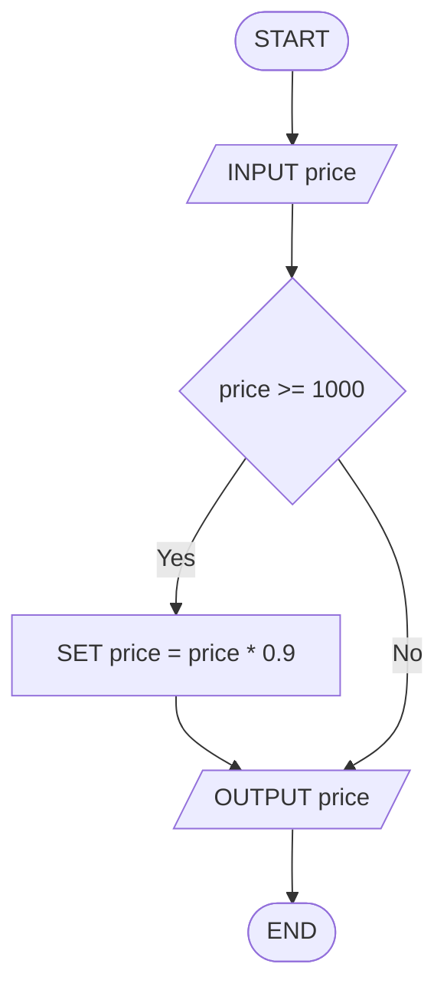

# Q18. Discount

[Source practice questions](https://github.com/codinggita/CGxSU_Semester_1/blob/main/Semester_1/python/09.Introduction_to_Problem_Solving/flowcharts_and_pseudocode.md)

## Pseudocode

```text
START
INPUT price
IF price >= 1000 THEN
    SET price = price * 0.9
END IF
OUTPUT price
END
```

## Flowchart



[Python solution](Q-18.py)
