# Q19. Password match

[Source practice questions](https://github.com/codinggita/CGxSU_Semester_1/blob/main/Semester_1/python/09.Introduction_to_Problem_Solving/flowcharts_and_pseudocode.md)

## Pseudocode

```text
START
INPUT password
IF password == 'python123' THEN
    OUTPUT 'Match'
ELSE
    OUTPUT 'No match'
END IF
END
```

## Flowchart

```mermaid
flowchart TD
    n0(["END"])
    n1{"password == &#x27;python123&#x27;"}
    n2[/"OUTPUT &#x27;Match&#x27;"/]
    n3[/"OUTPUT &#x27;No match&#x27;"/]
    n4[/"INPUT password"/]
    n5(["START"])
    n2 --> n0
    n3 --> n0
    n1 -->|Yes| n2
    n1 -->|No| n3
    n4 --> n1
    n5 --> n4
```



[Python solution](Q-19.py)
