# Q20. Temperature check

[Source practice questions](https://github.com/codinggita/CGxSU_Semester_1/blob/main/Semester_1/python/09.Introduction_to_Problem_Solving/flowcharts_and_pseudocode.md)

## Pseudocode

```text
START
INPUT temperature
IF temperature > 30 THEN
    OUTPUT 'Above 30'
ELSE
    IF temperature < 30 THEN
        OUTPUT 'Below 30'
    ELSE
        OUTPUT 'Equal to 30'
    END IF
END IF
END
```

## Flowchart

```mermaid
flowchart TD
    n0(["END"])
    n1{"temperature &gt; 30"}
    n2[/"OUTPUT &#x27;Above 30&#x27;"/]
    n3{"temperature &lt; 30"}
    n4[/"OUTPUT &#x27;Below 30&#x27;"/]
    n5[/"OUTPUT &#x27;Equal to 30&#x27;"/]
    n6[/"INPUT temperature"/]
    n7(["START"])
    n2 --> n0
    n4 --> n0
    n5 --> n0
    n3 -->|Yes| n4
    n3 -->|No| n5
    n1 -->|Yes| n2
    n1 -->|No| n3
    n6 --> n1
    n7 --> n6
```



[Python solution](Q-20.py)
