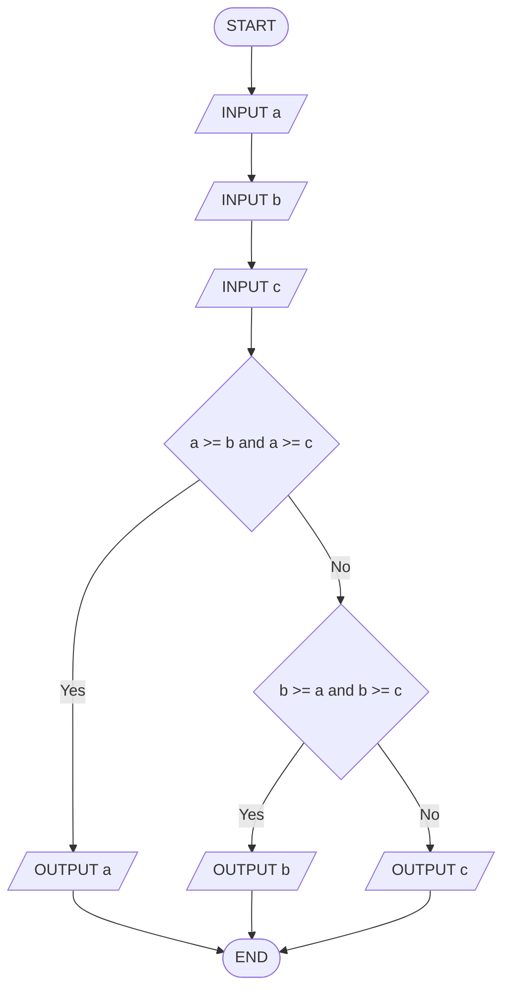

# Q21. Largest of three

[Source practice questions](https://github.com/codinggita/CGxSU_Semester_1/blob/main/Semester_1/python/09.Introduction_to_Problem_Solving/flowcharts_and_pseudocode.md)

## Pseudocode

```text
START
INPUT a
INPUT b
INPUT c
IF a >= b and a >= c THEN
    OUTPUT a
ELSE
    IF b >= a and b >= c THEN
        OUTPUT b
    ELSE
        OUTPUT c
    END IF
END IF
END
```

## Flowchart



[Python solution](Q-21.py)
