# Q22. Grade

[Source practice questions](https://github.com/codinggita/CGxSU_Semester_1/blob/main/Semester_1/python/09.Introduction_to_Problem_Solving/flowcharts_and_pseudocode.md)

## Pseudocode

```text
START
INPUT marks
IF marks >= 90 THEN
    OUTPUT 'A'
ELSE
    IF marks >= 75 THEN
        OUTPUT 'B'
    ELSE
        IF marks >= 60 THEN
            OUTPUT 'C'
        ELSE
            IF marks >= 40 THEN
                OUTPUT 'D'
            ELSE
                OUTPUT 'F'
            END IF
        END IF
    END IF
END IF
END
```

## Flowchart

```mermaid
flowchart TD
    n0(["END"])
    n1{"marks &gt;= 90"}
    n2[/"OUTPUT &#x27;A&#x27;"/]
    n3{"marks &gt;= 75"}
    n4[/"OUTPUT &#x27;B&#x27;"/]
    n5{"marks &gt;= 60"}
    n6[/"OUTPUT &#x27;C&#x27;"/]
    n7{"marks &gt;= 40"}
    n8[/"OUTPUT &#x27;D&#x27;"/]
    n9[/"OUTPUT &#x27;F&#x27;"/]
    n10[/"INPUT marks"/]
    n11(["START"])
    n2 --> n0
    n4 --> n0
    n6 --> n0
    n8 --> n0
    n9 --> n0
    n7 -->|Yes| n8
    n7 -->|No| n9
    n5 -->|Yes| n6
    n5 -->|No| n7
    n3 -->|Yes| n4
    n3 -->|No| n5
    n1 -->|Yes| n2
    n1 -->|No| n3
    n10 --> n1
    n11 --> n10
```



[Python solution](Q-22.py)
