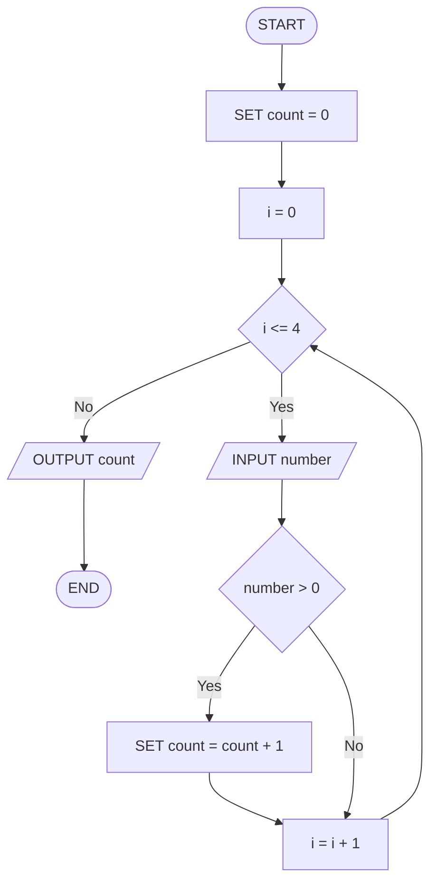

# Q24. Count positive numbers

[Source practice questions](https://github.com/codinggita/CGxSU_Semester_1/blob/main/Semester_1/python/09.Introduction_to_Problem_Solving/flowcharts_and_pseudocode.md)

## Pseudocode

```text
START
SET count = 0
FOR i FROM 0 TO 4 STEP 1
    INPUT number
    IF number > 0 THEN
        SET count = count + 1
    END IF
END FOR
OUTPUT count
END
```

## Flowchart



[Python solution](Q-24.py)
