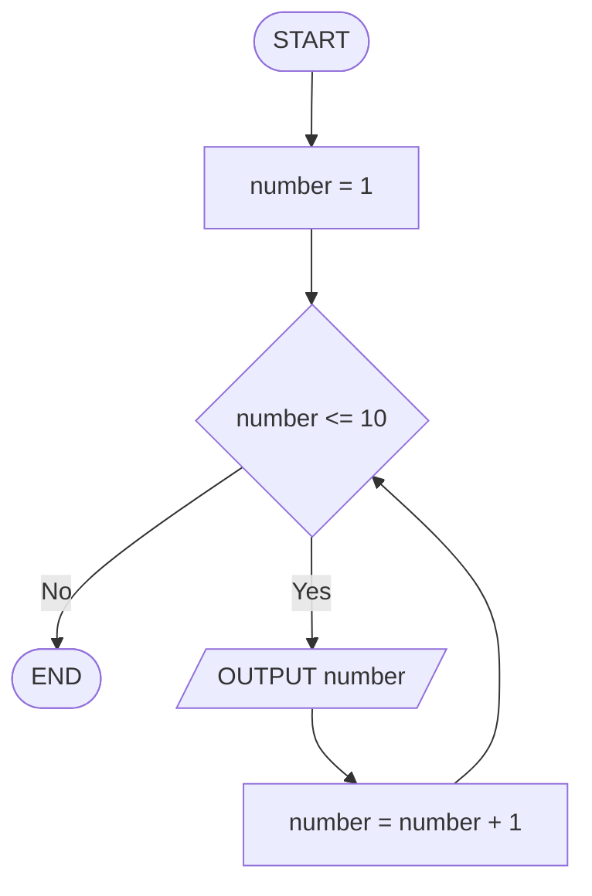

# Q27. Print one through ten

[Source practice questions](https://github.com/codinggita/CGxSU_Semester_1/blob/main/Semester_1/python/09.Introduction_to_Problem_Solving/flowcharts_and_pseudocode.md)

## Pseudocode

```text
START
FOR number FROM 1 TO 10 STEP 1
    OUTPUT number
END FOR
END
```

## Flowchart



[Python solution](Q-27.py)
