# Q29. Multiplication table

[Source practice questions](https://github.com/codinggita/CGxSU_Semester_1/blob/main/Semester_1/python/09.Introduction_to_Problem_Solving/flowcharts_and_pseudocode.md)

## Pseudocode

```text
START
INPUT number
FOR multiplier FROM 1 TO 10 STEP 1
    OUTPUT number, 'x', multiplier, '=', number * multiplier
END FOR
END
```

## Flowchart

```mermaid
flowchart TD
    n0(["END"])
    n1["multiplier = 1"]
    n2{"multiplier &lt;= 10"}
    n3["multiplier = multiplier + 1"]
    n4[/"OUTPUT number, &#x27;x&#x27;, multiplier, &#x27;=&#x27;, number * multiplier"/]
    n5[/"INPUT number"/]
    n6(["START"])
    n4 --> n3
    n1 --> n2
    n2 -->|Yes| n4
    n3 --> n2
    n2 -->|No| n0
    n5 --> n1
    n6 --> n5
```



[Python solution](Q-29.py)
