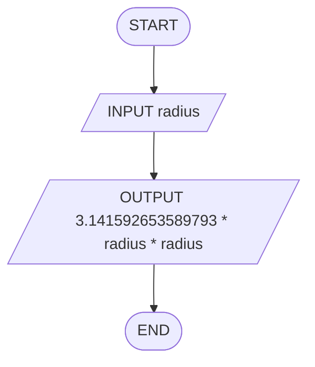

# Q6. Circle area

[Source practice questions](https://github.com/codinggita/CGxSU_Semester_1/blob/main/Semester_1/python/09.Introduction_to_Problem_Solving/flowcharts_and_pseudocode.md)

## Pseudocode

```text
START
INPUT radius
OUTPUT 3.141592653589793 * radius * radius
END
```

## Flowchart



[Python solution](Q-6.py)
