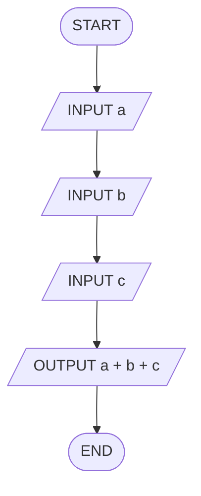

# Q7. Total marks

[Source practice questions](https://github.com/codinggita/CGxSU_Semester_1/blob/main/Semester_1/python/09.Introduction_to_Problem_Solving/flowcharts_and_pseudocode.md)

## Pseudocode

```text
START
INPUT a
INPUT b
INPUT c
OUTPUT a + b + c
END
```

## Flowchart



[Python solution](Q-7.py)
