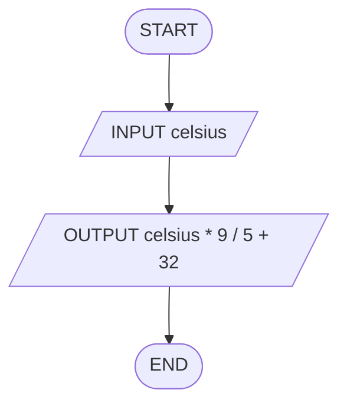

# Q9. Celsius to Fahrenheit

[Source practice questions](https://github.com/codinggita/CGxSU_Semester_1/blob/main/Semester_1/python/09.Introduction_to_Problem_Solving/flowcharts_and_pseudocode.md)

## Pseudocode

```text
START
INPUT celsius
OUTPUT celsius * 9 / 5 + 32
END
```

## Flowchart



[Python solution](Q-9.py)
